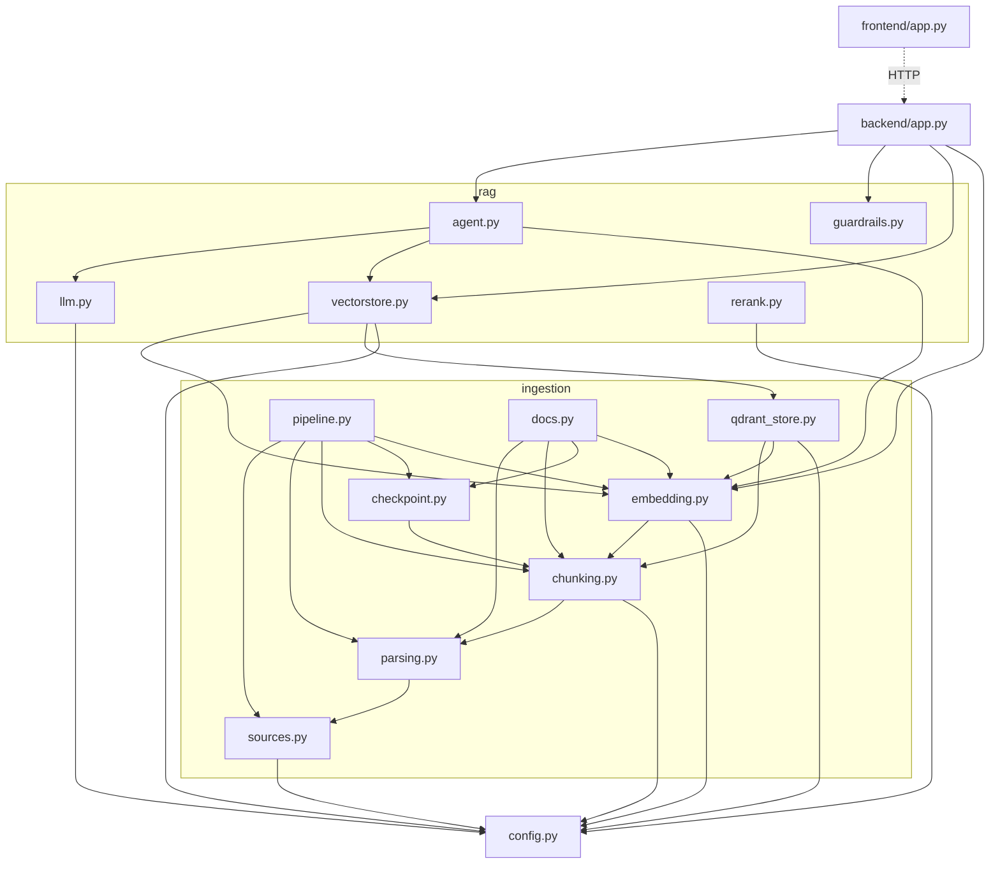
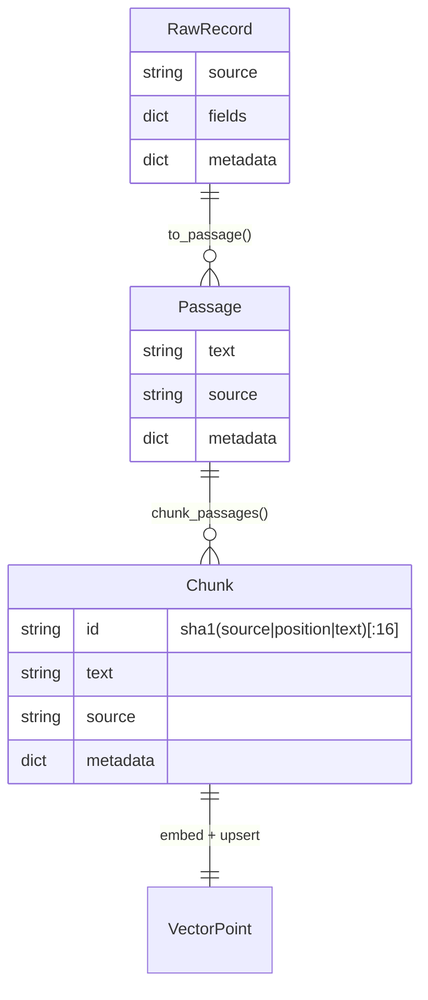

# Analyse du projet — Agent RAG SNCF

> Rapport généré par exploration statique du dépôt (code, config, CI, historique git). Les
> points marqués **[déduit]** sont des inférences plutôt que des faits vérifiés à l'exécution
> (les tests/lint n'ont pas pu être exécutés dans cet environnement : `uv` n'est pas installé
> ici, voir §3).

---

## 1. Vue d'ensemble

**Objectif du projet** [déduit du README, `plan-projet-sncf.md`, docstrings] : un agent
conversationnel qui répond en français à des questions sur des données ouvertes SNCF
(régularité des TGV, tarifs Intercités, règles de l'abonnement MAX JEUNE) via un pipeline RAG
(retrieval-augmented generation) et un agent LangGraph multi-corpus. Explicitement un
**projet portfolio** réalisé dans le cadre d'une recherche d'alternance en IA (README,
`plan-projet-sncf.md`) — l'accent est mis sur la démonstration de bonnes pratiques
d'ingénierie (éval avant optimisation, guardrails, gateway LLM, checkpointing) plutôt que sur
la couverture fonctionnelle exhaustive.

**Type de projet** : application web complète mais légère — API backend (FastAPI) + frontend
(Streamlit) + pipeline d'ingestion de données (CLI) + harnais d'évaluation (CLI). Ce n'est ni
une lib distribuable, ni un pur service API : c'est une démo full-stack conteneurisée et
déployée.

**Stack technique** (source : `pyproject.toml`, `uv.lock`) :

| Composant | Version minimale déclarée | Rôle |
|---|---|---|
| Python | ≥3.12 (`.python-version` = 3.12) | Langage |
| FastAPI | ≥0.115 | Backend API |
| Uvicorn | ≥0.32 | Serveur ASGI |
| Streamlit | ≥1.40 | Frontend |
| LangGraph | ≥0.2.60 | Orchestration agent (graphe d'état) |
| LangChain (+ community) | ≥0.3 | Abstractions LLM/RAG, `create_agent` |
| langchain-groq / -openai / -anthropic / -ollama / -huggingface / -qdrant | versions diverses | Intégrations providers/vectorstore |
| faiss-cpu | ≥1.9 | Vector store local (dev) |
| qdrant-client / langchain-qdrant | ≥1.18 / ≥1.1 | Vector store cloud (prod) |
| sentence-transformers | ≥3.3 | Embeddings + cross-encoder (rerank) |
| torch | ≥2 (résolu 2.13.0) | Backend des embeddings, forcé CPU-only sur Linux |
| pydantic-settings | ≥2.6 | Configuration typée (`.env`) |
| structlog | ≥24.4 | Logs structurés |
| logfire | ≥4.38 | Observabilité applicative |
| langsmith | ≥0.2 | Tracing de l'agent |
| portkey-ai | ≥2.3.2 | Gateway LLM (fallback, cache sémantique) |
| httpx, beautifulsoup4, pypdf | — | Extraction de données (API + web + PDF) |
| ragas, datasets (extra `eval`) | ≥0.2 / ≥3.0 | Évaluation RAG |
| pytest, ruff (dev) | ≥8.3 / ≥0.8 | Tests, lint |

Gestion des dépendances par **uv** (pas de `requirements.txt` ni de `Pipfile` — un seul
fichier de vérité `pyproject.toml` + lockfile `uv.lock`, donc pas de risque de
désynchronisation entre plusieurs manifestes). `uv.lock` résout **174 paquets** au total
(dépendances transitives incluses).

---

## 2. Architecture

### 2.1 Arborescence commentée

```
src/sncf_agent/
├── config.py                  Configuration centralisée (pydantic-settings, lit .env)
├── ingestion/                 Pipeline de données : source -> texte -> vector store
│   ├── sources.py             Connecteurs API (OpenDataConnector actif, NavitiaConnector stub)
│   ├── parsing.py             RawRecord -> Passage texte (formateurs par dataset + repli générique)
│   ├── chunking.py            Passage -> Chunk (découpage + id stable déterministe)
│   ├── checkpoint.py          Sauvegarde/lecture JSON intermédiaire (reprise sur panne)
│   ├── embedding.py           E5Embeddings (prefixes query/passage), construction index FAISS
│   ├── qdrant_store.py        Backend vectoriel Qdrant Cloud (alternative prod à FAISS)
│   ├── pipeline.py            Orchestrateur CLI : dataset structuré -> index (__main__)
│   └── docs.py                Orchestrateur CLI : corpus documentaire web/PDF -> index (__main__)
├── rag/                       Agent conversationnel et briques RAG
│   ├── llm.py                 Fabrique du chat model (BYOK / Portkey / direct)
│   ├── vectorstore.py         Point de bascule unique FAISS <-> Qdrant, seuils de pertinence
│   ├── rerank.py               Reranking cross-encodeur (optionnel, togglable)
│   ├── guardrails.py          Détection injection/PII (entrée), vérif. sources citées (sortie)
│   └── agent.py                Construction de l'agent LangGraph (mono-corpus et multi-corpus)
├── backend/
│   └── app.py                  API FastAPI : /chat, /search, /indexes, /health
└── frontend/
    └── app.py                  Interface Streamlit : chat + inspection retrieval

eval/
├── golden_set.json             29 questions/réponses de référence, 3 corpus + hors-domaine
└── harness.py                  Harnais d'éval RAGAS (__main__)

tests/                           Tests unitaires (chunking, guardrails, parsing)
data/{raw,checkpoints,index}/    Données générées (vides en dépôt, .gitkeep seulement)
```

### 2.2 Points d'entrée

| Point d'entrée | Commande | Rôle |
|---|---|---|
| `backend/app.py` (objet `app`) | `uvicorn sncf_agent.backend.app:app` | API FastAPI |
| `frontend/app.py` | `streamlit run src/sncf_agent/frontend/app.py` | UI web |
| `ingestion/pipeline.py` (`__main__`) | `python -m sncf_agent.ingestion.pipeline <dataset>` | Ingestion dataset structuré |
| `ingestion/docs.py` (`__main__`) | `python -m sncf_agent.ingestion.docs <corpus>` | Ingestion corpus documentaire |
| `eval/harness.py` (`__main__`) | `python -m eval.harness` | Évaluation RAGAS |

Tous exposés aussi via le `Makefile` (`make backend`, `make front`, `make ingest`, `make eval`, etc.).

### 2.3 Diagramme des dépendances internes



*(`frontend/app.py` n'importe volontairement pas le package `sncf_agent` — il appelle le
backend en HTTP, d'où la flèche pointillée. `guardrails.py` et `rerank.py` sont
volontairement peu couplés au reste : `guardrails` ne dépend d'aucun autre module interne.)*

### 2.4 Patterns d'architecture identifiés

- **Pipeline / ETL** pour l'ingestion : extraction → parsing → chunking → checkpoint →
  embedding → upsert, chaque étape isolée dans son propre module et testable indépendamment.
- **Interface commune + implémentations interchangeables (style ports-adapters léger)** à
  deux endroits clés, explicitement documentés dans le code :
  - `ingestion/sources.py` : `DataSource` (ABC) avec `OpenDataConnector` (implémenté) et
    `NavitiaConnector` (stub en attente de token) — même interface `fetch()`.
  - `rag/vectorstore.py` : point de bascule unique FAISS/Qdrant, piloté par
    `settings.vector_backend`, invisible pour l'agent et les guardrails.
- **Factory** pour le modèle de chat (`rag/llm.get_chat_model`) : centralise 3 chemins de
  construction (BYOK direct / gateway Portkey / appel direct classique) derrière une seule
  fonction.
- **Registre par décorateur** dans `ingestion/parsing.py` (`@register(dataset_id)`) pour
  associer un formateur texte à chaque dataset, avec repli générique — évite un `if/elif`
  géant et rend l'ajout d'un nouveau dataset additif (pas de modification du code existant).
- **Configuration centralisée typée** (`config.py`, `pydantic-settings`) : un seul point de
  vérité pour tous les paramètres/secrets, aucune lecture directe de `os.environ` ailleurs
  dans le code métier.
- Pas de couche ORM/base de données relationnelle — ce n'est pas une architecture en couches
  classique (pas de "repository pattern" pour de la persistance relationnelle), le "stockage"
  est soit un vector store, soit des fichiers JSON de checkpoint.
- Globalement : **petit monolithe modulaire** organisé par domaine fonctionnel
  (ingestion / rag / interfaces), pas de microservices, cohérent avec la taille du projet
  (~2 565 lignes de code Python au total, tests inclus).

---

## 3. Qualité et santé du code

**Tests** (`tests/`, 3 fichiers, ~26 fonctions de test) :

| Fichier | Couvre | Ce qui n'est PAS couvert |
|---|---|---|
| `test_chunking.py` | découpage, idempotence des ids, sérialisation `Chunk` | — |
| `test_parsing.py` | formateurs `regularite-mensuelle-tgv-aqst`, `tarifs-intercites`, repli générique, `_num` | formateur absent pour un 3e corpus visible ailleurs (`abonnement-max-jeune` passe par `docs.py`, pas de formateur dédié — cohérent, mais non testé) |
| `test_guardrails.py` | détection PII (email, tel, IBAN, CB+Luhn), injection, `verify_sources` | — |

**Aucun test** pour : `rag/agent.py` (construction agent, `ask_with_contexts`, extraction des
contextes depuis les `ToolMessage`), `rag/llm.py` (routage BYOK/Portkey/direct),
`rag/vectorstore.py` (`est_pertinent`, bascule FAISS/Qdrant), `rag/rerank.py`,
`backend/app.py` (aucun test d'endpoint FastAPI, pas de `TestClient`), `ingestion/sources.py`
(retry, `QuotaExceededError`), `ingestion/embedding.py`, `ingestion/qdrant_store.py`,
`ingestion/docs.py`, `ingestion/pipeline.py`, `eval/harness.py`.

Aucun outil de couverture configuré (pas de `pytest-cov` dans les dépendances dev, pas de
section `[tool.coverage]`) : **couverture non mesurable automatiquement**, mais au vu du
ratio (3 fichiers de test pour 20 modules source), elle est structurellement faible en dehors
du cœur "logique pure sans I/O" (parsing/chunking/guardrails) — précisément les parties les
plus faciles à tester unitairement, ce qui suggère un choix délibéré (tester ce qui est
déterministe et rapide, laisser le reste à l'éval RAGAS de bout en bout) plutôt qu'un oubli.
**[déduit]**

**Linting/formatage** : `ruff` configuré (`pyproject.toml`), règles `E, F, I, UP, B`
(pyflakes, erreurs pycodestyle, imports triés, pyupgrade, bugbear), `line-length = 100`,
`target-version = py312`. Pas de règles de complexité (`C90`), pas de règles docstring
(`D`), pas de `mypy`/vérification de types statique, pas de `black`/`ruff format` explicite
dans le Makefile (bien que `ruff` puisse aussi formater). **Pas de pre-commit hooks**
(`.pre-commit-config.yaml` absent) — le lint n'est appliqué qu'en CI et manuellement.

Les commandes `uv run ruff check .` et `uv run pytest` n'ont pas pu être exécutées dans cet
environnement d'analyse (`uv` absent du PATH ici) — non vérifié à l'exécution, mais la CI
GitHub Actions (`.github/workflows/python-app.yml`) exécute les deux à chaque push/PR sur
`main`.

**Code mort / TODO** : un seul marqueur `TODO(token)` dans `ingestion/sources.py:181`,
documenté et attendu (le connecteur Navitia est un stub volontaire en attente d'un token
d'API externe, pas de dette cachée). Aucun autre `TODO`/`FIXME`/`XXX` dans le code source.

**Fonctions longues/complexes** : `parsing._fmt_regularite` (~75 lignes) est la fonction la
plus longue du projet — construction incrémentale d'un texte à partir de ~15 champs
optionnels. Complexité justifiée par le nombre de champs, pas par un mauvais découpage ; reste
lisible (blocs commentés, un `if` par famille de champs). `backend/app.py::chat` (~85 lignes)
concentre guardrail d'entrée, BYOK, appel agent, gestion d'erreurs multiples et guardrail de
sortie — candidat raisonnable à une décomposition si l'endpoint doit encore grossir (voir §9).

**Duplication** : `ingestion/pipeline.py` et `ingestion/docs.py` répètent la même séquence
`chunk_passages → save_chunks → build_index` avec journalisation quasi identique (deux
orchestrateurs distincts pour deux types de sources — dataset structuré vs corpus
documentaire). `rag/agent.py::build_agent` et `build_multi_agent` partagent aussi une
structure proche (construction LLM + outils + `create_agent`). Duplication mineure, pas
bloquante à ce stade du projet.

**Gestion des erreurs et logs** : cohérente dans l'ensemble — `structlog` partout (20
occurrences réparties dans le code, jamais de `print` sauf dans `eval/harness.py` où c'est
volontaire pour l'affichage humain des scores), messages en français avec des clés
structurées (`log.info("evenement", cle=valeur)`). Erreurs personnalisées ciblées
(`QuotaExceededError`), retry exponentiel documenté dans `sources.py`. Quelques
`except Exception as exc:  # noqa: BLE001`, mais toujours accompagnés d'un commentaire
justifiant le choix (échauffement en tâche de fond qui ne doit jamais faire planter le
démarrage, erreurs LLM à traduire en réponse HTTP explicite) — pas des `except` silencieux.

---

## 4. Dépendances et dette technique

- **Un seul manifeste de dépendances** (`pyproject.toml` + `uv.lock`), donc pas de risque de
  désynchronisation entre `requirements.txt` et `pyproject.toml` (le projet n'a pas ce
  problème par construction).
- **Python minimal requis (3.12) = Python utilisé** (`.python-version` = `3.12`), cohérence
  vérifiée.
- **Dépendances déclarées mais non exploitées dans le code actuel** :
  - `langchain-anthropic` et `anthropic_api_key` (config) : le champ de configuration existe,
    mais `settings.llm_provider` ne documente que `ollama | groq | openai` (commentaire dans
    `config.py`) et aucun code n'instancie explicitement un modèle Anthropic. Dépendance
    présente pour une extension future, pas un mort-vivant à proprement parler, mais alourdit
    l'image/le lockfile pour une fonctionnalité non activée.
  - `langchain-huggingface` : présent dans `pyproject.toml`, aucun `import` trouvé dans le
    code (les embeddings passent par `sentence-transformers` directement, pas par ce
    wrapper LangChain).
  - Extra `scale` (`qdrant-client>=1.12`, `redis>=5.2`, `portkey-ai>=1.9`) : **redondant et
    partiellement obsolète** — `qdrant-client` et `portkey-ai` sont déjà des dépendances
    directes du groupe principal (avec des bornes de version plus récentes), et `redis`
    n'est utilisé nulle part dans le code (le cache sémantique est délégué à Portkey, pas
    implémenté en local). Cet extra semble être un reliquat de la feuille de route
    (`plan-projet-sncf.md` §1.2 mentionne Redis comme cache) jamais nettoyé après la
    migration de Qdrant/Portkey vers les dépendances principales.
- **Vulnérabilités connues** : non vérifiées dans cet environnement (pas d'accès à un outil
  d'audit type `pip-audit`/`uv audit`/GitHub Dependabot alerts depuis cette session, et aucun
  fichier `.github/dependabot.yml` n'est présent dans le dépôt — pas de scan automatique de
  vulnérabilités configuré côté CI). **Recommandation** plutôt qu'un constat : activer
  Dependabot ou un job `uv run pip-audit` en CI.
- **Poids des dépendances** : `torch` + `sentence-transformers` + `faiss-cpu` représentent
  l'essentiel du poids de l'image (le Dockerfile documente explicitement ce compromis — index
  PyPI CPU-only dédié pour éviter ~5 Go de libs CUDA inutiles). Choix technique déjà maîtrisé
  et documenté, pas une dette subie.

---

## 5. Configuration et environnement

- **Fichier de config** : `src/sncf_agent/config.py`, classe `Settings` (`pydantic-settings`),
  charge `.env` à la racine (`PROJECT_ROOT/.env`) via `pydantic-settings` **et** via
  `python-dotenv` (`load_dotenv`) en parallèle — le second sert à peupler `os.environ` pour
  les clients tiers (Groq, LangSmith...) qui lisent l'environnement directement plutôt que
  l'objet `Settings`. Double mécanisme volontaire et commenté, pas une redondance accidentelle.
- **Pas de fichier `.env.example`** dans le dépôt (absent de `find . -iname ".env*"`) : les
  variables sont documentées uniquement dans le README (section "Variables d'environnement
  principales") et en commentaires dans `config.py`. C'est utilisable mais moins pratique
  qu'un `.env.example` prêt à copier — quick win possible (§9).
- **Variables d'environnement principales** (`config.py`, `README.md`) :

| Variable | Défaut | Usage |
|---|---|---|
| `LLM_PROVIDER` / `LLM_MODEL` | `ollama` / `qwen2.5:7b` | Choix du LLM applicatif |
| `GROQ_API_KEY` / `OPENAI_API_KEY` / `ANTHROPIC_API_KEY` | vide | Clés providers |
| `OPENDATA_API_KEY` | vide | Relève le quota data.sncf.com (optionnel) |
| `SNCF_API_KEY` | vide | Token Navitia (en attente, non utilisé) |
| `VECTOR_BACKEND` | `faiss` | `faiss` \| `qdrant` |
| `QDRANT_CLUSTER_ENDPOINT` / `QDRANT_API_KEY` | vide | Connexion Qdrant Cloud |
| `RERANK_ENABLED` / `RERANK_MODEL` | `false` / cross-encoder mMiniLM | Reranking optionnel |
| `PORTKEY_API_KEY` / `PORTKEY_CONFIG` | vide | Gateway LLM |
| `LANGSMITH_*` | vides / `false` | Tracing agent |
| `PYDANTIC_LOGFIRE_API_KEY` | vide | Observabilité applicative (mappée vers `LOGFIRE_TOKEN`) |
| `BACKEND_URL` | `http://127.0.0.1:8000` | URL backend, lue par le frontend |

- **Gestion des secrets** : jamais de clé en dur (vérifié par lecture du code) ; `.env` est
  dans `.gitignore` et `.dockerignore` (double protection contre la fuite en commit ou en
  image Docker). En production (Fly.io), les secrets sont posés via `fly secrets set`
  (documenté en commentaire dans `fly.backend.toml`). Le mode **BYOK** (Bring Your Own Key)
  est une décision produit notable : en démo publique, la clé LLM du visiteur transite par
  requête sans jamais être stockée ni loguée (vérifié dans `backend/app.py` : la clé n'apparaît
  dans aucun `log.info`/`log.warning`).
- **Setup local** : `uv sync` (+ extras `eval`, `scale`), puis `make backend` / `make front`.
  Le `Makefile` sert de point d'entrée unique et documenté (`make help`), cohérent avec le
  README.
- **CI/CD existant** : un seul workflow GitHub Actions (`.github/workflows/python-app.yml`),
  déclenché sur push/PR vers `main`, qui installe les dépendances via `uv sync --frozen` puis
  exécute `ruff check .` et `pytest -q`. Pas de job de build/déploiement automatique
  (le déploiement Fly.io semble manuel via `fly deploy`, pas orchestré par la CI) — pas de
  `dependabot.yml`, pas de job de scan de sécurité, pas de job de type-checking.

---

## 6. Base de données / persistance

Pas de base de données relationnelle ni d'ORM. La persistance se fait à deux niveaux :

- **Checkpoints JSON** (`ingestion/checkpoint.py`) : liste de `Chunk` sérialisés
  (`data/checkpoints/<dataset>.json`), écrits après parsing/chunking et avant embedding, pour
  reprendre le pipeline sans re-télécharger/re-parser en cas d'échec de l'embedding.
- **Vector store**, deux backends interchangeables derrière `rag/vectorstore.py` :
  - **FAISS** (dev) : index sauvegardé sur disque (`data/index/<nom>/index.faiss` +
    métadonnées), chargé via `FAISS.load_local`.
  - **Qdrant Cloud** (prod) : collections nommées comme les index FAISS, dimension déduite
    dynamiquement de l'embedding (1024 pour e5-large), distance cosinus. Ids de point dérivés
    par UUID v5 depuis l'id de chunk (idempotence : ré-ingérer ne duplique pas).

Pas de migration de schéma au sens classique (pas de table relationnelle) : "changer de
schéma" ici revient à re-générer l'index/la collection en relançant le pipeline d'ingestion —
`build_qdrant` supprime et recrée la collection à chaque exécution (`delete_collection` puis
`create_collection`), ce qui est un choix simple mais destructif (voir §8).

Modèle de données simplifié :



---

## 7. API / interfaces

Backend FastAPI (`backend/app.py`), 4 endpoints :

| Méthode | Route | But | Schéma requête | Schéma réponse |
|---|---|---|---|---|
| GET | `/health` | Sonde de vie (liste aussi les index disponibles) | — | `{"status", "indexes"}` |
| GET | `/indexes` | Liste les index/collections vectoriels disponibles | — | `{"indexes": [str]}` |
| POST | `/search` | Retrieval brut avec scores (debug chunking/embedding) | `SearchRequest` | `SearchResponse` (liste de `SearchHit`) |
| POST | `/chat` | Réponse de l'agent RAG (mono-index ou multi-corpus) | `ChatRequest` | `ChatResponse` |

Schémas de requête/réponse en **Pydantic** (natif FastAPI), avec validation explicite : bornes
de longueur (`question`: 1–1000 caractères, `api_key`: 8–256), `k` borné (1–20), `history`
plafonné à 8 messages, `role` contraint par regex (`user|assistant`), `provider` contraint
(`groq|openai`). C'est une bonne pratique de guardrail "format/taille" au niveau du contrat
d'API, complémentaire aux guardrails métier (`rag/guardrails.py`).

Pas d'authentification sur l'API elle-même (pas de clé API serveur, pas de rate limiting
applicatif visible dans `backend/app.py`) — cohérent avec le choix produit BYOK/démo publique,
mais à noter si l'API venait à être exposée sans le frontend Streamlit devant (voir §8/§9).

---

## 8. Points de risque pour une évolution

- **Couplage au format texte des guardrails de sortie** : `verify_sources` (dans
  `guardrails.py`) parse les sources autorisées via une regex sur le format exact produit par
  `_format_docs` dans `rag/agent.py` (`"[Passage i | source: X]"`). Si le format d'un des deux
  côtés change sans changer l'autre, le guardrail de sortie devient silencieusement inopérant
  (aucun test croisé entre `agent._format_docs` et `guardrails.verify_sources` — chaque module
  est testé isolément avec des chaînes construites à la main). Zone fragile à ne pas modifier
  sans ajouter un test d'intégration.
- **Recréation destructive des collections Qdrant** : `qdrant_store.build_qdrant` supprime
  systématiquement la collection existante (`delete_collection`) avant de la recréer. Toute
  ré-ingestion partielle ou concurrente écrase l'intégralité du corpus en production — pas de
  mise à jour incrémentale malgré l'argument avancé en commentaire ("mises à jour
  incrémentales" comme avantage de Qdrant sur FAISS, non exploité dans le code actuel).
- **Agent et backend non testés** : `rag/agent.py` (extraction des contextes depuis les
  `ToolMessage`, gestion de la limite de récursion) et `backend/app.py` (routage BYOK, gestion
  des codes d'erreur 401/429/500) concentrent une logique métier non triviale sans aucun test
  automatisé. Une régression sur `ask_with_contexts` (ex. changement du type `ToolMessage` lors
  d'une montée de version LangGraph) ne serait détectée que par l'éval RAGAS ou en production.
- **Seuils de pertinence calibrés en dur** (`retrieval_score_threshold=0.35` pour FAISS,
  `qdrant_score_threshold=0.84` pour Qdrant) : documentés comme mesurés empiriquement sur les
  3 corpus actuels. Ajouter un 4e corpus avec une distribution de similarité différente
  pourrait invalider ces seuils sans avertissement — pas de mécanisme de calibration
  automatique ni d'alerte si un corpus entier tombe sous le seuil.
- **Dépendance à l'ordre des messages `ToolMessage`** dans `ask_with_contexts` : le
  découpage des contextes se fait par `split("\n\n")` sur la sortie concaténée de l'outil — si
  un passage source contenait lui-même un double saut de ligne (données textuelles longues via
  `docs.py`, PDF), le découpage des contextes RAGAS serait silencieusement incorrect (facteur
  de risque plutôt que bug confirmé — non testé sur des documents PDF réels ici).
- **Pas de dépendances circulaires** détectées entre modules internes (le graphe de
  dépendances en §2.3 est un DAG propre : `ingestion` ne dépend jamais de `rag`, `rag` ne
  dépend jamais de `backend`/`frontend`).
- **Conventions homogènes** : nommage cohérent (français pour les identifiants métier/logs,
  anglais pour les termes techniques), docstrings de module systématiques expliquant le
  "pourquoi". Pas d'incohérence de convention notable relevée entre les différentes parties du
  code.
- **Le frontend Streamlit à l'échelle** est un risque **déjà identifié et documenté par
  l'auteur lui-même** (`plan-projet-sncf.md`, encadré dédié) : une session serveur par
  utilisateur connecté ne scale pas à "des milliers d'utilisateurs simultanés". Ce n'est pas un
  point aveugle, mais un compromis de scope assumé — à garder en tête si le projet devait
  dépasser le cadre démo/portfolio.

---

## 9. Recommandations

**Quick wins (peu d'effort, bon impact)**

1. **Ajouter un `.env.example`** listant toutes les variables de `config.py` avec leurs
   valeurs par défaut/commentaires — réduit la friction de setup pour un nouveau contributeur
   (actuellement seulement documenté en prose dans le README).
2. **Nettoyer l'extra `scale`** (`pyproject.toml`) : `qdrant-client` et `portkey-ai` y sont
   dupliqués avec des bornes obsolètes par rapport aux dépendances principales, et `redis` n'a
   aucun usage dans le code — soit l'implémenter (cache Redis mentionné dans la feuille de
   route), soit retirer cet extra pour éviter la confusion.
3. **Activer un scan de vulnérabilités automatique** (Dependabot GitHub, ou un job
   `uv run pip-audit` dans la CI existante) — actuellement aucun mécanisme de ce type n'est en
   place alors que le projet dépend de ~174 paquets.
4. **Ajouter un test d'intégration `agent.py` ↔ `guardrails.verify_sources`** qui fait
   vraiment passer une sortie de `_format_docs` dans `verify_sources`, pour verrouiller le
   contrat de format entre les deux modules (risque identifié en §8).
5. **Documenter/retirer `langchain-anthropic` et `langchain-huggingface`** : soit brancher
   réellement le provider Anthropic dans `rag/llm.py` (le champ de config existe déjà), soit
   retirer la dépendance si elle n'est pas prévue à court terme.

**Chantiers plus lourds (impact structurant)**

6. **Tests pour `backend/app.py`** (via `fastapi.testclient.TestClient`) : couvrir au minimum
   les codes d'erreur (401 clé invalide, 429/503 quota, 404 index inconnu) et le routage
   BYOK — c'est la surface la plus exposée en production et actuellement la moins testée.
   Impact élevé, effort modéré (FastAPI facilite ces tests).
7. **Tests pour `rag/agent.py::ask_with_contexts`** avec un LLM/outil factices (fake
   `ToolMessage`) pour verrouiller l'extraction des contextes — c'est la donnée d'entrée de la
   métrique de faithfulness RAGAS *et* du guardrail de sortie, donc un point de défaillance à
   fort impact silencieux.
8. **Mise à jour incrémentale Qdrant** au lieu de `delete_collection` + recréation complète, si
   le corpus est amené à grossir en production — actuellement toute ré-ingestion est une
   opération destructive sur l'intégralité de la collection.
9. **Vérification de type statique (`mypy` ou `pyright`)** en complément de `ruff` : le code
   est déjà bien typé (annotations systématiques, `from __future__ import annotations`), donc
   le coût d'introduction serait faible pour un gain de robustesse réel — actuellement rien
   n'empêche une incohérence de type de passer le lint.
10. **Rate limiting / auth minimale sur l'API** si le backend FastAPI devait un jour être
    exposé indépendamment du frontend Streamlit (actuellement `/chat` et `/search` sont
    ouverts sans clé API ni limite de débit applicative — acceptable en l'état car la démo
    publique est BYOK et peu incitative à l'abus, mais à revoir si l'usage change).

---

## Résumé exécutif

Projet portfolio compact (~2 565 lignes) mais soigné : architecture en pipeline claire,
interfaces bien isolées (vector store et provider LLM interchangeables sans toucher au reste),
guardrails et évaluation RAGAS pris au sérieux, décisions d'ingénierie documentées et
justifiées plutôt que suivies par défaut. La principale faiblesse est le déséquilibre de test
— la logique pure (parsing, chunking, guardrails) est bien couverte, mais l'agent LangGraph et
l'API FastAPI, qui concentrent l'essentiel du risque de régression silencieuse, n'ont aucun
test automatisé. Dette technique globalement faible et volontairement assumée (Streamlit à
l'échelle, stub Navitia), pas de dépendances circulaires ni d'incohérences de convention.
Priorité recommandée : combler les tests backend/agent avant toute évolution fonctionnelle
majeure.
