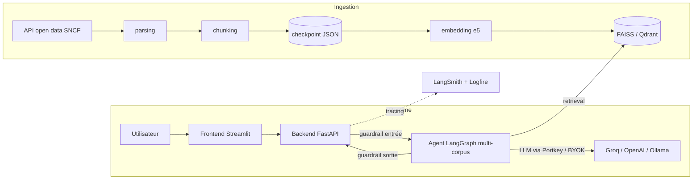

# 🚆 Agent conversationnel RAG SNCF

Assistant conversationnel qui répond à des questions sur les données ouvertes de la SNCF
(régularité des TGV, tarifs Intercités, règles de l'abonnement MAX JEUNE) via un pipeline
RAG et un agent LangGraph multi-corpus. Il cite ses sources, refuse honnêtement quand il
n'a pas l'information, et n'invente jamais de chiffres.

**🔗 Démo en ligne : [sncf-agent-frontend.fly.dev](https://sncf-agent-frontend.fly.dev/)**

> La démo est hébergée en *scale-to-zero* (coût nul au repos) : au premier accès, la
> machine se réveille en ~1 min (un statut « Réveil du backend » s'affiche), puis les
> réponses sont instantanées. La démo fonctionne en **BYOK** : saisissez votre propre clé
> API Groq (gratuite sur [console.groq.com](https://console.groq.com)) dans les réglages.

Projet portfolio réalisé dans le cadre d'une recherche d'alternance en IA. Feuille de
route technique complète : [`plan-projet-sncf.md`](plan-projet-sncf.md).

---

## Ce que le projet démontre

- **Agent RAG multi-corpus** (LangGraph `create_agent`) : un outil de recherche par
  domaine, l'agent route lui-même la question vers le bon corpus.
- **Pipeline d'ingestion avec checkpoint** : `API SNCF → parsing → chunking → JSON
  intermédiaire → embedding → vector store`. Le checkpoint évite de tout relancer si
  l'embedding échoue.
- **Évaluation avant optimisation** : golden set de 29 Q/R + métriques RAGAS rejouables.
  Chaque changement (prompt, chunking, retrieval) se valide en relançant l'éval.
- **Guardrails** en entrée (injection de prompt, PII) et en sortie (vérification des
  sources citées).
- **Gateway LLM** (Portkey) : fallback Groq → OpenAI et cache sémantique.
- **Vector store basculable** FAISS (dev) ↔ Qdrant (prod), derrière une seule interface.
- **Déploiement** conteneurisé sur Fly.io, CI GitHub Actions (lint + tests),
  observabilité LangSmith (tracing agent) + Logfire (applicatif).

---

## Architecture



Le retrieval est filtré par un seuil de pertinence : si aucun passage n'est assez proche,
l'agent le dit au lieu de raisonner sur du hors-sujet.

---

## Résultats d'évaluation (RAGAS)

Golden set de 29 questions (in-domain sur les 3 corpus + questions hors périmètre),
agent et juge sur `gpt-4o-mini`. Les contextes évalués sont ceux **réellement vus par
l'agent** (extraits de ses appels d'outil), pour une mesure de fidélité juste.

| Métrique | Score | Ce qu'elle mesure |
|---|---|---|
| Context recall | **0,87** | Les passages couvrent-ils la réponse de référence |
| Faithfulness | **0,77** | La réponse est-elle fidèle aux passages (grounding) |
| Answer relevancy | 0,60 | La réponse répond-elle à la question |
| Context precision | 0,58 | Les passages récupérés sont-ils pertinents |

### Exemple de décision guidée par l'éval : le reranking

Un reranking cross-encodeur (retrieve-then-rerank) a été implémenté, puis **mesuré** :
aucun gain significatif (écarts < 0,04, dans le bruit de RAGAS). Sur un corpus petit et
bien séparé, le bi-encodeur e5-large sature déjà le retrieval. Le reranking est donc
**conservé mais désactivé par défaut** (`RERANK_ENABLED`), prêt pour un corpus plus grand.
Mesurer avant d'activer, plutôt que de suivre la mode.

---

## Stack

| Brique | Choix | Note |
|---|---|---|
| Backend | FastAPI | endpoints `/chat`, `/search`, `/indexes`, `/health` |
| Frontend | Streamlit | onglet chat + inspection du retrieval (scores) |
| Agent / RAG | LangGraph + LangChain (LCEL, `create_agent`) | pas d'API dépréciée |
| Embeddings | `intfloat/multilingual-e5-large` | local, CPU, préfixes query/passage |
| Vector store | FAISS (dev) / Qdrant (prod) | basculable via `VECTOR_BACKEND` |
| LLM | Ollama `qwen2.5:7b` (dev), Groq / OpenAI (BYOK), Portkey (gateway) | |
| Éval | RAGAS (juge OpenAI) | golden set + test de régression |
| Observabilité | LangSmith (EU) + Logfire | tracing agent + applicatif |
| Déploiement | Fly.io + Docker + GitHub Actions | scale-to-zero |

---

## Installation

Le projet utilise [uv](https://docs.astral.sh/uv/).

```bash
uv sync                      # dépendances + venv
uv sync --extra eval         # + RAGAS (évaluation)
uv sync --extra scale        # + Qdrant / Redis / Portkey

# Renseigner les clés API dans un fichier .env (voir variables ci-dessous)
```

Variables d'environnement principales (toutes optionnelles selon l'usage) :
`OPENDATA_API_KEY` (relève le quota data.sncf.com), `GROQ_API_KEY` / `OPENAI_API_KEY`,
`VECTOR_BACKEND` (`faiss`|`qdrant`), `QDRANT_CLUSTER_ENDPOINT` / `QDRANT_API_KEY`,
`PORTKEY_API_KEY` / `PORTKEY_CONFIG`, `LANGSMITH_*`, `RERANK_ENABLED`.

## Commandes

```bash
# Ingestion d'un dataset (extraction → parsing → chunking → checkpoint → vector store)
uv run python -m sncf_agent.ingestion.pipeline <dataset_id> --where "<clause ODSQL>"

# Backend (charge le modèle e5 au démarrage) puis frontend dans un autre terminal
uv run uvicorn sncf_agent.backend.app:app --host 127.0.0.1 --port 8000
uv run streamlit run src/sncf_agent/frontend/app.py

# Éval, tests, lint
uv run python -m eval.harness --label baseline
uv run pytest
uv run ruff check .
```

Un `Makefile` regroupe ces cibles (`make help`).

---

## Structure

```
src/sncf_agent/
  config.py          Configuration centralisée (pydantic-settings, lit .env)
  ingestion/         API SNCF → parsing → chunking → checkpoint → embedding → FAISS/Qdrant
  rag/               agent LangGraph, vector store, llm (Portkey), rerank, guardrails
  backend/           API FastAPI
  frontend/          interface Streamlit
eval/                golden set + évaluation RAGAS
tests/               tests unitaires
```

---

## Décisions d'ingénierie notables

- **Deux sources SNCF distinctes** : data.sncf.com (Opendatasoft, sans token, source du
  prototype) et api.sncf.com (Navitia, temps réel, derrière une interface commune en
  attente du token).
- **BYOK en production** : la démo publique utilise la clé du visiteur (appel direct au
  provider, jamais loguée) plutôt qu'une clé serveur, pour un coût nul et sans fuite.
  Portkey ne sert qu'en dev, où ce sont mes clés à protéger.
- **Scale-to-zero assumé** : le fractionnement coût/latence est un choix produit (démo
  éco), géré côté frontend par une attente gracieuse au réveil.
- **Mémoire conversationnelle stateless** : l'historique est renvoyé par le client à
  chaque requête, cohérent avec le scale-to-zero (la conversation survit aux redémarrages).
